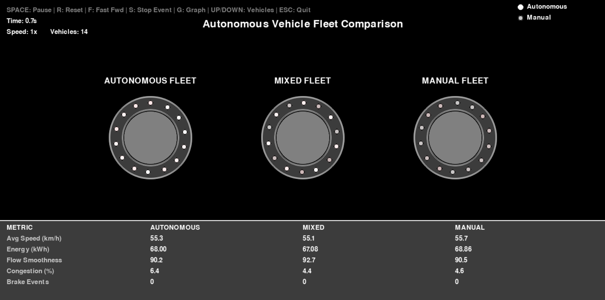

# Autonomous Vehicle Fleet Simulation

[](https://www.python.org/downloads/)
[](https://www.pygame.org/)
[](LICENSE)

A real-time visual simulation demonstrating the efficiency advantages of **autonomous vehicle fleets** compared to mixed and manual fleets. This project showcases how vehicle-to-vehicle (V2V) communication enables smoother traffic flow, reduced energy consumption, and faster recovery from disruptions.



## Key Features

- **Side-by-side Comparison**: Three roundabouts running simultaneously (Autonomous, Mixed, Manual)
- **Realistic Vehicle Behavior**:
  - Autonomous vehicles coordinate through V2V communication
  - Manual vehicles have realistic reaction delays
  - Collision avoidance and adaptive speed control
- **Real-time Metrics Dashboard**: Speed, energy consumption, flow smoothness, congestion
- **Interactive Controls**: Pause, speed up, trigger stop events to test recovery
- **Live Graph Visualization**: Track any metric over time across all three fleets

## Installation

### Prerequisites
- Python 3.8 or higher
- pip package manager

### Setup

```bash
# Clone the repository
git clone https://github.com/SantiagoBarreiroCampos/autonomous-fleet-simulation.git
cd autonomous-fleet-simulation

# Create virtual environment (recommended)
python -m venv venv
source venv/bin/activate  # On Windows: venv\Scripts\activate

# Install dependencies
pip install -r requirements.txt
```

## Usage

```bash
python run.py
```

## Controls

| Key | Action |
|-----|--------|
| `SPACE` | Pause/Resume simulation |
| `R` | Reset simulation |
| `F` | Cycle speed (1x → 2x → 4x → 8x) |
| `S` (hold) | Trigger stop event to test recovery |
| `G` | Toggle real-time graph window |
| `↑` `↓` | Increase/decrease vehicle count |
| `←` `→` | Change graph metric |
| `ESC` | Quit |

## How It Works

### Autonomous Fleet
- Vehicles communicate instantly via V2V
- Maintain optimal spacing through coordination
- React immediately to changes ahead
- Result: **Smooth, efficient traffic flow**

### Manual Fleet  
- Vehicles have reaction delays (0.15-0.2 seconds)
- Cannot anticipate traffic changes
- Random speed variations (human inconsistency)
- Result: **Stop-and-go waves, higher energy use**

### Mixed Fleet
- Alternating autonomous and manual vehicles
- Autonomous vehicles help stabilize flow
- Still affected by manual vehicle limitations
- Result: **Intermediate performance**

## Metrics Explained

| Metric | Description | Better When |
|--------|-------------|-------------|
| **Avg Speed (km/h)** | Mean velocity of all vehicles | Higher |
| **Energy (kWh)** | Cumulative energy consumption | Lower |
| **Flow Smoothness** | Evenness of vehicle spacing | Higher |
| **Congestion (%)** | Vehicles below target speed | Lower |
| **Brake Events** | Count of significant slowdowns | Lower |

## Project Structure

```
autonomous-fleet-simulation/
├── run.py                 # Main entry point
├── requirements.txt       # Dependencies
├── README.md
├── LICENSE
├── .gitignore
├── src/
│   ├── __init__.py
│   ├── config.py          # Configuration parameters
│   ├── models.py          # Vehicle data models
│   ├── roundabout.py      # Roundabout simulation logic
│   ├── simulation.py      # Main simulation controller
│   └── ui.py              # Rendering and UI components
└── docs/
    └── screenshot.png
```

## Technical Details

### Simulation Parameters
- **Roundabout radius**: 80 pixels (40 meters)
- **Vehicles per roundabout**: 14 (adjustable with ↑/↓)
- **Base speed**: 35 units (~63 km/h real-world)
- **Time scale**: 1x (real-time)

### Energy Model
Energy consumption accounts for:
1. **Base consumption**: Proportional to speed (rolling resistance, air drag)
2. **Acceleration penalty**: Quadratic cost for speed changes

This model demonstrates why stop-and-go traffic is inefficient compared to smooth flow.

## Expected Results

After running the simulation, you should observe:

| Fleet Type | Speed | Energy | Flow | Congestion |
|------------|-------|--------|------|------------|
| Autonomous | Highest | Lowest | Smoothest | Lowest |
| Mixed | Medium | Medium | Medium | Medium |
| Manual | Lowest | Highest | Choppy | Highest |

**Try the Stop Event (hold S)** to see how each fleet recovers from a sudden disruption!

## Contributing

Contributions are welcome! Please feel free to submit a Pull Request.

## License

This project is licensed under the MIT License - see the [LICENSE](LICENSE) file for details.

## Acknowledgments

- Built with [Pygame](https://www.pygame.org/)
- Inspired by research on autonomous vehicle platooning and V2V communication